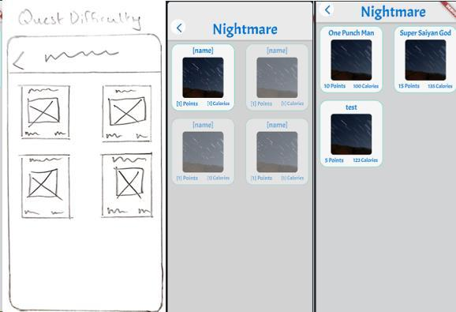

# FitQuest

A gamified fitness application prototype built with FlutterFlow and Supabase. BSc (Hons) Computing final-year project, University of Greenwich.

## Project aim

Explore how exercise quests, goals, rewards and progress feedback could support motivation and engagement with a fitness application.

## My contribution

- Researched competing fitness applications using Nielsen's usability heuristics.
- Defined and prioritised requirements using MoSCoW, use cases and UML.
- Designed the user journey and interface through wireframes and prototypes.
- Developed bodyweight exercise quests, points, badges and a leaderboard.
- Modelled application data in a six-table PostgreSQL database using Supabase.
- Documented implementation screens, workflows and prototype evaluation.

## Explore the work

- [Portfolio report](portfolio-report.pdf): research, design, implementation and evaluation.
- [Presentation](A%20Web-Based%20Gamified%20Fitness%20System%20Which%20Enhances%20Motivation.pptx).
- The original exported project archive remains in the repository.

The report is the clearest starting point because it explains the development process alongside screenshots. A public live demo is not currently linked here.

## Running the prototype

The repository contains an exported project archive rather than a complete hosted application. Inspect its contents before choosing a Flutter/FlutterFlow workflow. Running the prototype may require compatible Flutter dependencies, project configuration and a separately configured Supabase backend with its tables and access policies. Do not assume the original backend remains available.

No fresh build or deployment has been verified as part of this portfolio presentation update.

## Evaluation scope

This is an academic prototype. Its evaluation documents the project's design and implementation; it does not establish a measured improvement in real users' fitness or motivation.

## Context

Project by Tejesh Ramesh Bawa. The preview is extracted from the final report. The portfolio PDF omits the student identifier.
